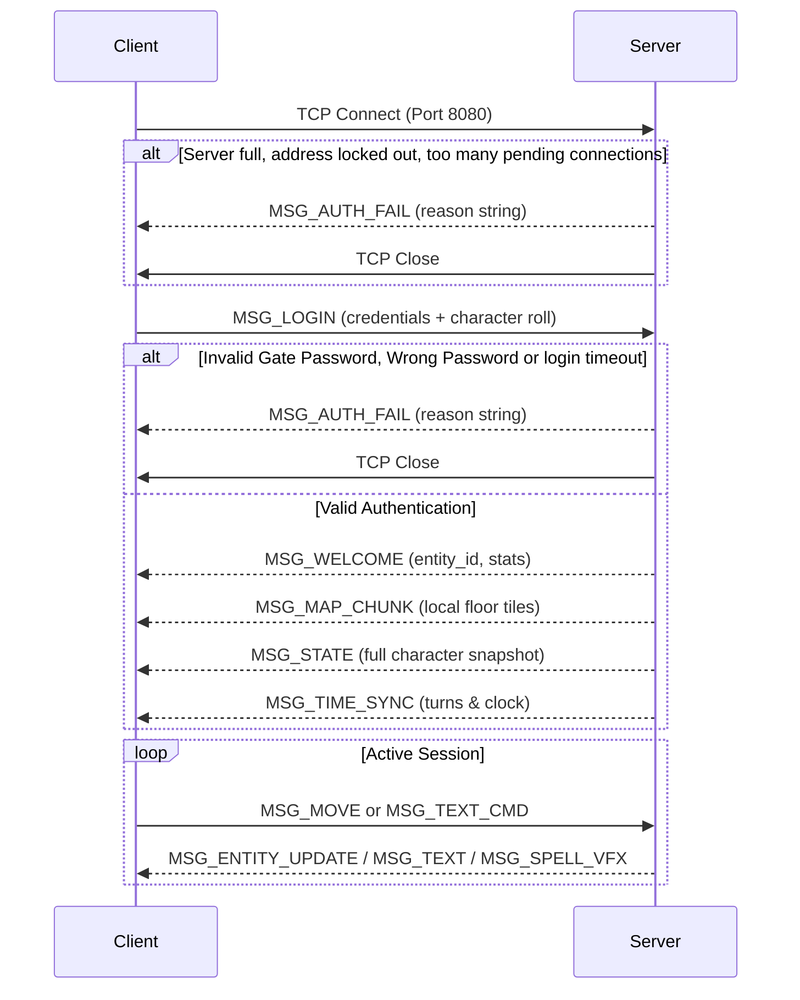

# Dragon GL — Network Protocol Specification

This document defines the binary client-server protocol of Dragon GL. The in-memory message structs live in `include/protocol.h`; the encoding is implemented once, in `src/shared/wire.c` (`include/wire.h`), and used by both the server (`src/server/server_net.c`, `src/server/server_conn.c`) and the client (`src/client/net_thread.c`, `src/client/main_client.c`).

Current protocol version: **`PROTOCOL_VERSION 4`**.

---

## 1. Transport & Framing

- **Transport:** TCP. Default port **8080** (`-P` / `--port`). The server listens on every address, IPv6 and IPv4 (dual-stack socket; IPv4 only on hosts without IPv6). The client resolves a host name, an IPv4 or an IPv6 address with `getaddrinfo()` and tries every address, 5 s each.
- **Encoding:** every field is written explicitly, little-endian, with the width given below. No struct is ever sent as raw memory, so the format does not depend on the compiler, the struct padding or the host byte order.
- **Frame:** an 8-byte header followed by the payload.

| Offset | Size | Field |
|---:|---:|:---|
| 0 | 2 | `version` — `PROTOCOL_VERSION` (4) |
| 2 | 2 | `type` — message type (table below) |
| 4 | 4 | `length` — payload bytes after the header |

- **Strings:** `u8 length` followed by that many bytes, no NUL. Each string has a field size (NUL included) on the receiving side; a longer string is a protocol error, never silently truncated.
- **Strictness:** a payload must decode completely and be consumed exactly. Wrong version, a type the peer may not send, a length above the limit for its type, a truncated payload, trailing bytes, an out-of-range count, enum, coordinate or tile value: the receiver closes the connection.
- **Limits:** a client payload is at most 256 bytes (`WIRE_MAX_CLIENT_PAYLOAD`); a server payload at most 72 KiB (a 256×256 map chunk).

> **Versioning:** any change to the wire format increments `PROTOCOL_VERSION`. Both ends reject any other version at the first frame, so mismatched builds fail with a clear message instead of misreading the stream.

---

## 2. Message Types

| Value | Identifier | Direction | Payload | Description |
|:---:|:---|:---:|:---|:---|
| `1` | `MSG_LOGIN` | C → S | see 3.1 | Authentication, and the creation choices of a new character |
| `2` | `MSG_WELCOME` | S → C | 37 bytes | Login accepted: entity id, position, vital stats |
| `3` | `MSG_MOVE` | C → S | 2 bytes | One step `(dx, dy)` |
| `4` | `MSG_STATE` | S → C | variable | Full character sheet, or the identity of an entity seen for the first time |
| `5` | `MSG_MAP_CHUNK` | S → C | 8 + w·h bytes | A rectangle of floor tiles |
| `6` | `MSG_TEXT_CMD` | C → S | string (255) | Console command |
| `7` | `MSG_TEXT` | S → C | string (255) | Console output, chat, combat log |
| `8` | `MSG_AUTH_FAIL` | S → C | string (127) | Why the login or the connection was refused |
| `9` | `MSG_SPELL_VFX` | S → C | 12 bytes | Spell visual effect |
| `10` | `MSG_TOMBSTONE_REMOVE` | S → C | 4 bytes | A tombstone was emptied |
| `11` | `MSG_TIME_SYNC` | S → C | 6 bytes | Game clock |
| `12` | `MSG_ENTITY_UPDATE` | S → C | 2 + 12·n bytes | Position and HP of entities already known to the client |
| `13` | `MSG_COMBAT_EVENT` | S → C | 9 bytes | What the floating combat text shows |

---

## 3. Message Payloads

Notation: `i8 i16 i32` signed, `u8 u16 u32 u64` unsigned, `bool` one byte 0/1, `f32` IEEE-754 bits, `str(N)` a string of at most N bytes.

### 3.1 `MSG_LOGIN` (Client → Server)
| Field | Type | Notes |
|:---|:---|:---|
| `username` | `str(31)` | `[A-Za-z0-9_]{1,16}`, or `dm` for the Dungeon Master |
| `password` | `str(63)` | Personal password (1-63 printable characters), verified with Argon2id |
| `server_pass` | `str(63)` | Server access password (8-63 characters) |
| `race_id`, `subrace_id`, `class_id`, `alignment` | `i8` × 4 | Used only when the character does not exist yet (`subrace_id` -1 = none) |

The ability scores of a new character are rolled by the server.

### 3.2 `MSG_WELCOME` (Server → Client)
`i32 entity_id`, `i32 x`, `i32 y`, `bool is_new`, `i32 hp`, `i32 max_hp`, `u64 gold`, `i8 race_id`, `i8 subrace_id`, `i8 class_id`, `i32 level`, `i8 alignment`.

### 3.3 `MSG_MOVE` (Client → Server)
`i8 dx`, `i8 dy`, each in -1..1.

### 3.4 `MSG_STATE` (Server → Client)
In order: `u64 gold`; `i32` entity_id, x, y, hp, max_hp, floor_id, game_hour, game_min, total_turns, str, dex, con, intel, wis, cha; `f32 movement_cooldown`; `i32` equipped_mask, level, xp, vision_radius, ac; `u32 status_icons`; `str(31)` weapon_name, armor_name; `i32` to_hit, to_dmg; `u32 bosses_defeated`; `i32 hunger_level`; `i32 spell_slots[10]`; `i32 spell_slots_max[10]`; `str(31)` × 24 for the equipment (head, neck, body, back, right hand, left hand, hands, right arm, left arm, feet, 10 rings, 4 belt slots); `bool is_merchant`; `i8 shop_spec`; `bool is_tombstone`; `bool is_player`; `str(31) username`.

A state with `hp <= 0` for another entity removes it from the client (it died or left the floor).

### 3.5 `MSG_MAP_CHUNK` (Server → Client)
`i16 start_x`, `i16 start_y`, `i16 width`, `i16 height`, then `width × height` tile bytes, row by row. Width and height are 1..256, the rectangle lies inside the 300×300 map and every tile is a valid `VoxelType` (below `VOXEL_COUNT`).

### 3.6 `MSG_ENTITY_UPDATE` (Server → Client)
`u16 count` (1..4096), then `count` records of 12 bytes: `i32 entity_id`, `i16 x`, `i16 y`, `i32 hp`. Only entities the client already received a `MSG_STATE` for; unknown ids are ignored.

### 3.7 `MSG_TEXT`, `MSG_TEXT_CMD`, `MSG_AUTH_FAIL`
One string each: `str(255)`, `str(255)`, `str(127)`. The server replaces control characters in commands with spaces before they reach the game.

### 3.8 `MSG_SPELL_VFX` (Server → Client)
`i16 start_x`, `i16 start_y`, `i16 target_x`, `i16 target_y`, `u8 vfx_type` (projectile 0, explosion 1, aura 2, ...), `u8 r`, `u8 g`, `u8 b` (colour, 0-255).

### 3.9 `MSG_TOMBSTONE_REMOVE`, `MSG_TIME_SYNC`
`i32 entity_id` (a tombstone id, negative). `u8 game_hour` (0-23), `u8 game_min` (0-59), `i32 total_turns`.

### 3.10 `MSG_COMBAT_EVENT` (Server → Client)
`u8 kind`, `i32 entity_id`, `i32 amount`. The client draws floating combat text from these events; it used to guess them by matching the English wording of `MSG_TEXT` lines.

| `kind` | Meaning | `amount` |
|:---:|:---|:---|
| 1 | The player took damage | HP lost |
| 2 | The player hit a monster (`entity_id`) | damage |
| 3 | Critical hit on a monster | damage |
| 4 | A monster missed the player | 0 |
| 5 | The player missed | 0 |
| 6 | The player recovered HP | HP |
| 7 | The player picked up gold | gold |
| 8 | Level up | new level |

---

## 4. Connection Lifecycle

### Server-side limits

The server never waits on a single connection: input is buffered per client and only complete messages are handled, output is queued and written when the socket accepts it. The limits below are defined in `src/server/server_conn.h`.

| Limit | Value | Effect when exceeded |
| --- | --- | --- |
| Time from TCP accept to a successful `MSG_LOGIN` | 10 s | `MSG_AUTH_FAIL` "Login timeout.", connection closed |
| Unauthenticated connections from one address | 8 | new connection refused with `MSG_AUTH_FAIL` |
| Failed logins (gate, DM or character password) from one address | 5 within 60 s | address locked out for 60 s; connections refused with `MSG_AUTH_FAIL` |
| Concurrent clients | 64 (`MAX_CLIENTS`) | `MSG_AUTH_FAIL` "Server full", connection closed |
| Sessions per character | 1 | second `MSG_LOGIN` refused with `MSG_AUTH_FAIL` "Character already online." |
| Silent peer (no traffic, no FIN) | TCP keepalive: 60 s idle, 3 probes 10 s apart | connection closed, character saved and released |
| Unsent output queued for one client | 2 MiB | client disconnected (it is not reading) |

Any of the following closes the connection: a header with a wrong `version`, a type a client may not send, a `length` above the limit of its type, a payload that does not decode exactly (see section 1), `MSG_MOVE` or `MSG_TEXT_CMD` before `MSG_LOGIN`, a second `MSG_LOGIN` on an authenticated session.

The password check of a `MSG_LOGIN` runs in a worker thread, so `MSG_WELCOME` (or `MSG_AUTH_FAIL`) may take a few tens of milliseconds. Messages a client sends after `MSG_LOGIN` and before the answer are kept and handled, in order, once the login succeeds; nothing is read from the socket in between.
