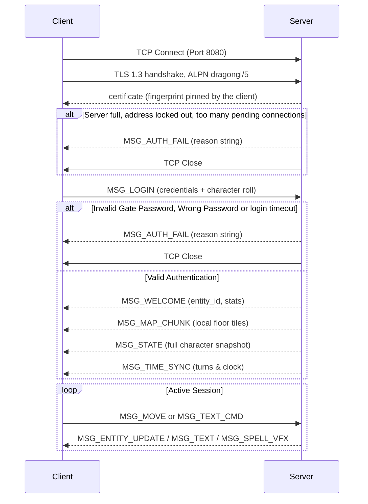

# Dragon GL — Network Protocol Specification

This document defines the binary client-server protocol of Dragon GL. The messages are defined once, in `protocol/messages.json`: `tools/gen_protocol.py` generates from that table the C structs (`include/protocol_gen.h`), the codec (`include/wire.h`, `src/shared/wire.c`, used by the server in `src/server/server_net.c` and `src/server/server_conn.c` and by the client in `src/client/net_thread.c` and `src/client/main_client.c`), the conformance test of the C codec (`tests/test_protocol_conformance.c`), the test vectors (`tests/protocol_vectors.json`) and sections 2 and 3 of this document. The Python codec of the tests (`protocol/codec.py`) reads the same table. CI fails when a generated file is stale (`tools/gen_protocol.py --check`).

Current protocol version: **`PROTOCOL_VERSION 5`**.

---

## 1. Transport & Framing

- **Transport:** TCP, then TLS 1.3 (OpenSSL 3; older TLS versions are refused). Default port **8080** (`-P` / `--port`). The server listens on every address, IPv6 and IPv4 (dual-stack socket; IPv4 only on hosts without IPv6). The client resolves a host name, an IPv4 or an IPv6 address with `getaddrinfo()` and tries every address, 5 s each.
- **Protocol negotiation:** the client offers the ALPN protocol `dragongl/5`, the only one the server accepts. A client of another protocol version fails the handshake with a `no_application_protocol` alert, before any frame; a client that offers no ALPN protocol is disconnected after the handshake.
- **Server identity:** the server presents its certificate (`--tls-cert` / `--tls-key`, by default `<state dir>/tls/server.crt` and `server.key`, a self-signed ECDSA P-256 certificate created at the first start) and logs its SHA-256 fingerprint at start-up. The client accepts the server when the fingerprint is the one given with `--fingerprint`, when an authority the system trusts signed the certificate for the host name typed, or when `known_servers` (trust on first use, like SSH's `known_hosts`) already has that fingerprint for the host and port; at the first connection it records the fingerprint. A different certificate for a recorded server is refused. See `SECURITY.md` for the threat model.
- **Encoding:** every field is written explicitly, little-endian, with the width given below. No struct is ever sent as raw memory, so the format does not depend on the compiler, the struct padding or the host byte order.
- **Frame:** an 8-byte header followed by the payload.

| Offset | Size | Field |
|---:|---:|:---|
| 0 | 2 | `version` — `PROTOCOL_VERSION` (5) |
| 2 | 2 | `type` — message type (table below) |
| 4 | 4 | `length` — payload bytes after the header |

- **Strings:** `u8 length` followed by that many bytes, no NUL. Each string has a field size (NUL included) on the receiving side; a longer string is a protocol error, never silently truncated.
- **Strictness:** a payload must decode completely and be consumed exactly. Wrong version, a type the peer may not send, a length above the limit for its type, a truncated payload, trailing bytes, an out-of-range count, enum, coordinate or tile value: the receiver closes the connection. Encoders refuse the same values, so a peer never sends what the other side would refuse.
- **Limits:** the largest payload of each message is in the table below (`WIRE_MAX_PAYLOAD_<MSG>`); a client payload is at most `WIRE_MAX_CLIENT_PAYLOAD` bytes, a server payload at most `WIRE_MAX_SERVER_PAYLOAD` (a 256×256 map chunk).

> **Versioning:** any change to the wire format increments `PROTOCOL_VERSION` (and so the ALPN protocol). Both ends reject any other version at the handshake, so mismatched builds fail with a clear message instead of misreading the stream.

---

## 2. Message Types

<!-- BEGIN GENERATED: messages -->
| Value | Identifier | Direction | Max payload | Description |
|:---:|:---|:---:|---:|:---|
| `1` | [`MSG_LOGIN`](#msg_login) | C → S | 164 | Authentication, and the creation choices of a new character |
| `2` | [`MSG_WELCOME`](#msg_welcome) | S → C | 37 | Login accepted: entity id, position, vital stats |
| `3` | [`MSG_MOVE`](#msg_move) | C → S | 2 | One step `(dx, dy)` |
| `4` | [`MSG_STATE`](#msg_state) | S → C | 1060 | Full character sheet, or the identity of an entity seen for the first time |
| `5` | [`MSG_MAP_CHUNK`](#msg_map_chunk) | S → C | 65544 | A rectangle of floor tiles |
| `6` | [`MSG_TEXT_CMD`](#msg_text_cmd) | C → S | 256 | Console command |
| `7` | [`MSG_TEXT`](#msg_text) | S → C | 256 | Console output, chat, combat log |
| `8` | [`MSG_AUTH_FAIL`](#msg_auth_fail) | S → C | 128 | Why the login or the connection was refused |
| `9` | [`MSG_SPELL_VFX`](#msg_spell_vfx) | S → C | 12 | Spell visual effect |
| `10` | [`MSG_TOMBSTONE_REMOVE`](#msg_tombstone_remove) | S → C | 4 | A tombstone was emptied |
| `11` | [`MSG_TIME_SYNC`](#msg_time_sync) | S → C | 6 | Game clock |
| `12` | [`MSG_ENTITY_UPDATE`](#msg_entity_update) | S → C | 49154 | Position and HP of entities already known to the client |
| `13` | [`MSG_COMBAT_EVENT`](#msg_combat_event) | S → C | 9 | What the floating combat text shows |
<!-- END GENERATED: messages -->

---

## 3. Message Payloads

<!-- BEGIN GENERATED: payloads -->
Notation: `i8 i16 i32` signed, `u8 u16 u32 u64` unsigned, `bool` one byte 0/1, `f32` IEEE-754 bits, `str(N)` a string of at most N bytes (`u8` length, then the bytes, no NUL). Fields follow each other in the order of the table, nothing between them. A value outside its range is a protocol error.

**`EntityUpdateRec`** (12 bytes): Position and HP of one entity.

| Field | Type | Range |
|:---|:---|:---|
| `entity_id` | `i32` |  |
| `x` | `i16` |  |
| `y` | `i16` |  |
| `hp` | `i32` |  |

### MSG_LOGIN

Authentication, and the creation choices of a new character (C → S, type 1, at most 164 bytes).

| Field | Type | Range | Notes |
|:---|:---|:---|:---|
| `username` | `str(31)` |  | `[A-Za-z0-9_]{1,16}`, or `dm` for the Dungeon Master |
| `password` | `str(63)` |  | Personal password (1-63 printable characters), verified with Argon2id |
| `server_pass` | `str(63)` |  | Server access password (8-63 characters) |
| `race_id` | `i8` |  | RaceType |
| `subrace_id` | `i8` |  | SubraceType, -1 = none |
| `class_id` | `i8` |  | ClassType |
| `alignment` | `i8` |  | Alignment |

The creation fields are used only when the character does not exist yet; the ability scores of a new character are rolled by the server.

### MSG_WELCOME

Login accepted: entity id, position, vital stats (S → C, type 2, at most 37 bytes).

| Field | Type | Range | Notes |
|:---|:---|:---|:---|
| `entity_id` | `i32` |  |  |
| `x` | `i32` |  |  |
| `y` | `i32` |  |  |
| `is_new` | `bool` |  | the character was just created |
| `hp` | `i32` |  |  |
| `max_hp` | `i32` |  |  |
| `gold` | `u64` |  |  |
| `race_id` | `i8` |  |  |
| `subrace_id` | `i8` |  |  |
| `class_id` | `i8` |  |  |
| `level` | `i32` |  |  |
| `alignment` | `i8` |  |  |

### MSG_MOVE

One step `(dx, dy)` (C → S, type 3, at most 2 bytes).

| Field | Type | Range | Notes |
|:---|:---|:---|:---|
| `dx` | `i8` | -1..1 |  |
| `dy` | `i8` | -1..1 |  |

### MSG_STATE

Full character sheet, or the identity of an entity seen for the first time (S → C, type 4, at most 1060 bytes).

| Field | Type | Range | Notes |
|:---|:---|:---|:---|
| `gold` | `u64` |  |  |
| `entity_id` | `i32` |  |  |
| `x` | `i32` |  |  |
| `y` | `i32` |  |  |
| `hp` | `i32` |  |  |
| `max_hp` | `i32` |  |  |
| `floor_id` | `i32` |  |  |
| `game_hour` | `i32` |  |  |
| `game_min` | `i32` |  |  |
| `total_turns` | `i32` |  |  |
| `str` | `i32` |  |  |
| `dex` | `i32` |  |  |
| `con` | `i32` |  |  |
| `intel` | `i32` |  |  |
| `wis` | `i32` |  |  |
| `cha` | `i32` |  |  |
| `movement_cooldown` | `f32` |  | seconds between two steps |
| `equipped_mask` | `i32` |  |  |
| `level` | `i32` |  |  |
| `xp` | `i32` |  |  |
| `vision_radius` | `i32` |  |  |
| `ac` | `i32` |  |  |
| `status_icons` | `u32` |  | bitmask of status icons |
| `weapon_name` | `str(31)` |  |  |
| `armor_name` | `str(31)` |  |  |
| `to_hit` | `i32` |  |  |
| `to_dmg` | `i32` |  |  |
| `bosses_defeated` | `u32` |  | bitmask of the 10 bosses |
| `hunger_level` | `i32` |  |  |
| `spell_slots` | `i32 × 10` |  |  |
| `spell_slots_max` | `i32 × 10` |  |  |
| `eq_head` | `str(31)` |  |  |
| `eq_neck` | `str(31)` |  |  |
| `eq_body` | `str(31)` |  |  |
| `eq_back` | `str(31)` |  |  |
| `eq_hand_r` | `str(31)` |  |  |
| `eq_hand_l` | `str(31)` |  |  |
| `eq_hands` | `str(31)` |  |  |
| `eq_arm_r` | `str(31)` |  |  |
| `eq_arm_l` | `str(31)` |  |  |
| `eq_feet` | `str(31)` |  |  |
| `eq_ring` | `str(31) × 10` |  |  |
| `eq_belt` | `str(31) × 4` |  |  |
| `is_merchant` | `bool` |  |  |
| `shop_spec` | `i8` |  | MerchantSpecialization, -1 = not a merchant |
| `is_tombstone` | `bool` |  |  |
| `is_player` | `bool` |  |  |
| `username` | `str(31)` |  |  |

A state with `hp <= 0` for another entity removes it from the client (it died or left the floor).

### MSG_MAP_CHUNK

A rectangle of floor tiles (S → C, type 5, at most 65544 bytes).

| Field | Type | Range | Notes |
|:---|:---|:---|:---|
| `start_x` | `i16` | ≥ 0 |  |
| `start_y` | `i16` | ≥ 0 |  |
| `width` | `i16` | 1..256 (`WIRE_MAX_CHUNK_SIDE`) |  |
| `height` | `i16` | 1..256 (`WIRE_MAX_CHUNK_SIDE`) |  |
| `tiles` | `u8[width*height]` | each ≤ 27 (`VOXEL_COUNT - 1`) | `VoxelType` of every tile |

Also: `start_x + width <= MAP_WIDTH` (the rectangle lies inside the map).

Also: `start_y + height <= MAP_HEIGHT` (the rectangle lies inside the map).

The tiles follow row by row; they stay in the payload buffer (`tiles` points into it after decoding).

### MSG_TEXT_CMD

Console command (C → S, type 6, at most 256 bytes).

| Field | Type | Range | Notes |
|:---|:---|:---|:---|
| `cmd` | `str(255)` |  |  |

The server replaces control characters with spaces before the command reaches the game.

### MSG_TEXT

Console output, chat, combat log (S → C, type 7, at most 256 bytes).

| Field | Type | Range | Notes |
|:---|:---|:---|:---|
| `text` | `str(255)` |  |  |

### MSG_AUTH_FAIL

Why the login or the connection was refused (S → C, type 8, at most 128 bytes).

| Field | Type | Range | Notes |
|:---|:---|:---|:---|
| `reason` | `str(127)` |  |  |

### MSG_SPELL_VFX

Spell visual effect (S → C, type 9, at most 12 bytes).

| Field | Type | Range | Notes |
|:---|:---|:---|:---|
| `start_x` | `i16` |  |  |
| `start_y` | `i16` |  |  |
| `target_x` | `i16` |  |  |
| `target_y` | `i16` |  |  |
| `vfx_type` | `u8` |  | 0 burst, 1 explosion, 2 aura, 3 ray, 4 storm |
| `color_r` | `u8 (0..1 × 255)` |  | colour channel 0..1 as 0-255 |
| `color_g` | `u8 (0..1 × 255)` |  |  |
| `color_b` | `u8 (0..1 × 255)` |  |  |

### MSG_TOMBSTONE_REMOVE

A tombstone was emptied (S → C, type 10, at most 4 bytes).

| Field | Type | Range | Notes |
|:---|:---|:---|:---|
| `entity_id` | `i32` |  | tombstone id (negative) |

### MSG_TIME_SYNC

Game clock (S → C, type 11, at most 6 bytes).

| Field | Type | Range | Notes |
|:---|:---|:---|:---|
| `game_hour` | `u8` | ≤ 23 |  |
| `game_min` | `u8` | ≤ 59 |  |
| `total_turns` | `i32` |  |  |

### MSG_ENTITY_UPDATE

Position and HP of entities already known to the client (S → C, type 12, at most 49154 bytes).

| Field | Type | Range | Notes |
|:---|:---|:---|:---|
| `recs` | `u16 count, then records` | 1..4096 (`WIRE_MAX_ENTITY_RECS`) records | `EntityUpdateRec` records |

Only entities the client already received a `MSG_STATE` for; unknown ids are ignored.

### MSG_COMBAT_EVENT

What the floating combat text shows (S → C, type 13, at most 9 bytes).

| Field | Type | Range | Notes |
|:---|:---|:---|:---|
| `kind` | `u8` | 1..8 (`COMBAT_EV_MAX`) | CombatEventKind |
| `entity_id` | `i32` |  |  |
| `amount` | `i32` |  |  |

`kind`: 1 the player took damage (amount = HP lost), 2 the player hit a monster (`entity_id`, damage), 3 critical hit on a monster, 4 a monster missed the player, 5 the player missed, 6 the player recovered HP, 7 the player picked up gold, 8 level up (amount = new level). The client draws floating combat text from these events, never from the wording of `MSG_TEXT` lines.
<!-- END GENERATED: payloads -->

---

## 4. Connection Lifecycle

### Server-side limits

The server never waits on a single connection: input is buffered per client and only complete messages are handled, output is queued and written when the socket accepts it. The limits below are defined in `src/server/server_conn.h`.

| Limit | Value | Effect when exceeded |
| --- | --- | --- |
| Time from TCP accept to a successful `MSG_LOGIN` (the TLS handshake included) | 10 s | `MSG_AUTH_FAIL` "Login timeout." (if the handshake was completed), connection closed |
| Refused connections being told why (server full, locked out, too many pending) | 16 at a time, 3 s each | beyond that, the connection is closed without a reason |
| Unauthenticated connections from one address | 8 | new connection refused with `MSG_AUTH_FAIL` |
| Failed logins (gate, DM or character password) from one address | 5 within 60 s | address locked out for 60 s; connections refused with `MSG_AUTH_FAIL` |
| Concurrent clients | 64 (`MAX_CLIENTS`) | `MSG_AUTH_FAIL` "Server full", connection closed |
| Sessions per character | 1 | second `MSG_LOGIN` refused with `MSG_AUTH_FAIL` "Character already online." |
| Silent peer (no traffic, no FIN) | TCP keepalive: 60 s idle, 3 probes 10 s apart | connection closed, character saved and released |
| Unsent output queued for one client | 2 MiB | client disconnected (it is not reading) |

Any of the following closes the connection: a header with a wrong `version`, a type a client may not send, a `length` above the limit of its type, a payload that does not decode exactly (see section 1), `MSG_MOVE` or `MSG_TEXT_CMD` before `MSG_LOGIN`, a second `MSG_LOGIN` on an authenticated session.

The password check of a `MSG_LOGIN` runs in a worker thread, so `MSG_WELCOME` (or `MSG_AUTH_FAIL`) may take a few tens of milliseconds. Messages a client sends after `MSG_LOGIN` and before the answer are kept and handled, in order, once the login succeeds; nothing is read from the socket in between.
