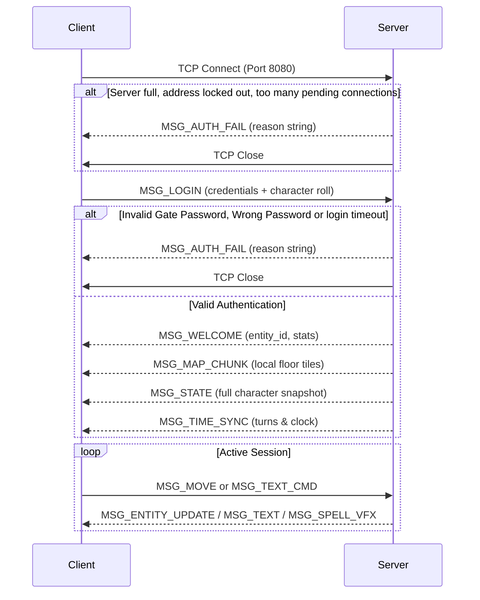

# Dragon GL — Network Protocol Specification

This document defines the binary client-server network protocol of Dragon GL, as implemented in `include/protocol.h`, `src/server/server_net.c`, and `src/client/net_client.c`.

Current protocol version: **`PROTOCOL_VERSION 3`**.

---

## 1. Transport & Framing

- **Transport:** Standard TCP stream. Default port: **8080** (configurable with `-P` or `--port`).
- **Endianness:** Host byte order (little-endian on supported x86_64 architectures).
- **Packet Structure:** Every message sent across the network begins with a standard 12-byte header (`MsgHeader`), followed immediately by the payload:

```c
typedef struct {
    uint32_t type;      /* MsgType identifier */
    int32_t  length;    /* Payload length in bytes (excluding this header) */
    uint16_t version;   /* PROTOCOL_VERSION (currently 3) */
    uint16_t reserved;  /* Must be 0 */
} MsgHeader;
```

> **Protocol Versioning:** When the wire format changes, `PROTOCOL_VERSION` is incremented. Both server and client immediately reject packets with mismatched versions to prevent stream corruption.

---

## 2. Message Types

| Value | Identifier | Direction | Payload Structure | Description |
|:---:|:---|:---:|:---|:---|
| `1` | `MSG_LOGIN` | C → S | `MsgLogin` | Client authentication or new character registration |
| `2` | `MSG_WELCOME` | S → C | `MsgWelcome` | Successful login confirmation and initial character stats |
| `3` | `MSG_MOVE` | C → S | `MsgMove` | Directional movement vector `(dx, dy, dz)` |
| `4` | `MSG_STATE` | S → C | `MsgState` | Full entity/player status snapshot (stats, gear, HP, icons) |
| `5` | `MSG_MAP_CHUNK`| S → C | `MsgMapChunk` + voxels | Voxel terrain chunk data |
| `6` | `MSG_TEXT_CMD` | C → S | `MsgTextCmd` | Player console command string |
| `7` | `MSG_TEXT` | S → C | `MsgText` | Server text output, chat message, or combat log feedback |
| `8` | `MSG_AUTH_FAIL`| S → C | `MsgAuthFail` | Authentication error message |
| `9` | `MSG_SPELL_VFX`| S → C | `MsgSpellVFX` | Dynamic visual effect dispatch (particles, AoE burst) |
| `10`| `MSG_TOMBSTONE_REMOVE` | S → C | `MsgTombstoneRemove`| Notifies client that a death tombstone was looted/removed |
| `11`| `MSG_TIME_SYNC`| S → C | `MsgTimeSync` | Synchronizes in-game clock, turn counter, and day/night cycle |
| `12`| `MSG_ENTITY_UPDATE` | S → C | `int32 count` + `EntityUpdateRec[]` | Lightweight position and HP deltas for tracked entities |

---

## 3. Message Payloads

### `MSG_LOGIN` (Client → Server)
Carries credentials and initial character roll parameters:
- `char username[32]`: Character name (or `"dm"` for administrator).
- `char password[32]`: Personal character password (hashed on server).
- `char server_pass[32]`: Gate access password for server admission.
- `int race_id, subrace_id, class_id`: Lineage and profession identifiers.
- `int is_new_char`: `1` if creating a new character, `0` for existing.
- `int str, dex, con, intel, wis, cha`: Core d20 attribute rolls.
- `int age, height, weight, social_class, alignment`: Roleplay characteristics.

### `MSG_WELCOME` (Server → Client)
Returned when authentication succeeds:
- `int entity_id`: Assigned network entity ID for the player.
- `int x, y`: Starting coordinates on the floor.
- `int success`: `1` if authenticated, `0` on error.
- `int is_new`: `1` if character was newly initialized in the database.
- `int hp, max_hp, level`: Character vital stats.
- `uint64_t gold`: Starting currency.

### `MSG_MOVE` (Client → Server)
Relative step request:
- `int entity_id`: Player entity ID.
- `int dx, dy, dz`: Delta offsets (`-1, 0, 1`).

### `MSG_STATE` (Server → Client)
Comprehensive state update containing full character sheet information:
- Player position `(x, y)`, `floor_id`, `hp`, `max_hp`, `ac`, `level`, `xp`, `gold`.
- Attributes: `str, dex, con, intel, wis, cha`, `to_hit`, `to_dmg`.
- `uint32_t status_icons`: Active condition bitmask (Burning, Poisoned, Bleeding, etc.).
- `uint32_t bosses_defeated`: Bitmask indicating which 10-floor bosses have been defeated (illuminating HUD trophies).
- `int hunger_level`: Current vitality and starvation index.
- `int spell_slots[10]`, `spell_slots_max[10]`: Available grimoire slots.
- Equipment strings: `eq_head`, `eq_neck`, `eq_body`, `eq_back`, `eq_hand_r`, `eq_hand_l`, `eq_hands`, `eq_arm_r`, `eq_arm_l`, `eq_feet`, `eq_ring[10]`, `eq_belt[4]`.

### `MSG_ENTITY_UPDATE` (Server → Client)
Lightweight delta packet sent to update visible monsters and nearby adventurers without the overhead of full `MsgState` messages:
- `int32_t count`: Number of entity delta records.
- Followed by array of `EntityUpdateRec` (12 bytes each):
  ```c
  typedef struct {
      int32_t entity_id;
      int16_t x;
      int16_t y;
      int32_t hp;
  } EntityUpdateRec;
  ```

### `MSG_MAP_CHUNK` (Server → Client)
Transmits procedural voxel maps to the client:
- Header: `int16_t start_x, start_y, width, height` (8 bytes).
- Payload: `uint8_t voxels[width * height]` raw voxel index grid.

### `MSG_SPELL_VFX` (Server → Client)
Dispatches visual particle effects:
- `int start_x, start_y`: Origin coordinates.
- `int target_x, target_y`: Impact / explosion coordinates.
- `int vfx_type`: Projectile (`0`), Explosion (`1`), or Aura (`2`).
- `float color_r, color_g, color_b`: Normalized RGB color for particle rendering.

---

## 4. Connection Lifecycle



### Server-side limits

The server never waits on a single connection: input is buffered per client and only complete messages are handled, output is queued and written when the socket accepts it. The limits below are defined in `src/server/server_conn.h`.

| Limit | Value | Effect when exceeded |
| --- | --- | --- |
| Time from TCP accept to a successful `MSG_LOGIN` | 10 s | `MSG_AUTH_FAIL` "Login timeout.", connection closed |
| Unauthenticated connections from one address | 8 | new connection refused with `MSG_AUTH_FAIL` |
| Failed logins (gate, DM or character password) from one address | 5 within 60 s | address locked out for 60 s; connections refused with `MSG_AUTH_FAIL` |
| Concurrent clients | 64 (`MAX_CLIENTS`) | `MSG_AUTH_FAIL` "Server full", connection closed |
| Unsent output queued for one client | 2 MiB | client disconnected (it is not reading) |

Any of the following closes the connection: a header with a wrong `version`, a non-zero `reserved` field, a type a client may not send, a `length` different from the exact payload size of its type, `MSG_MOVE` or `MSG_TEXT_CMD` before login, a second `MSG_LOGIN` on an authenticated session.
