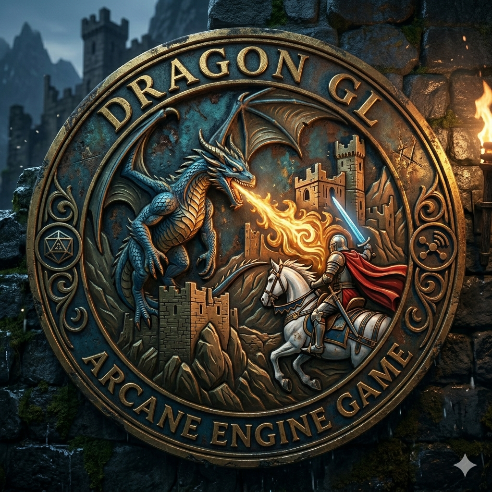
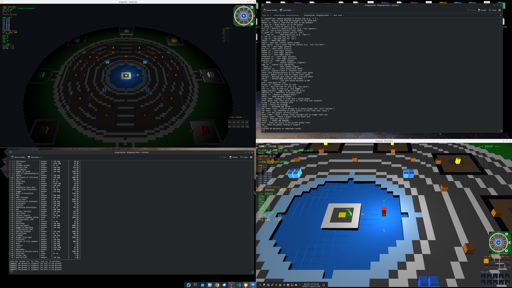
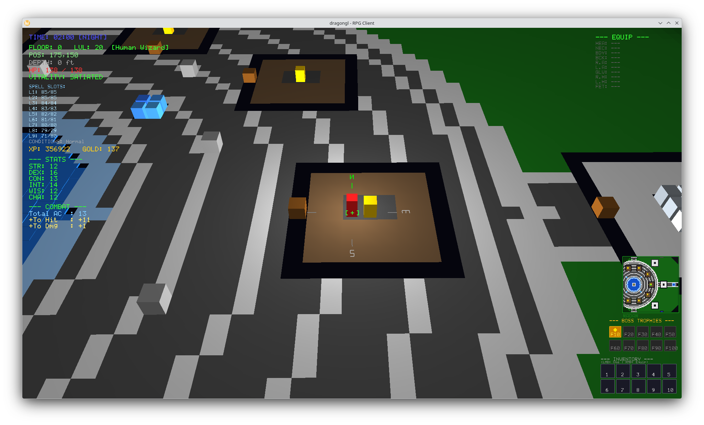
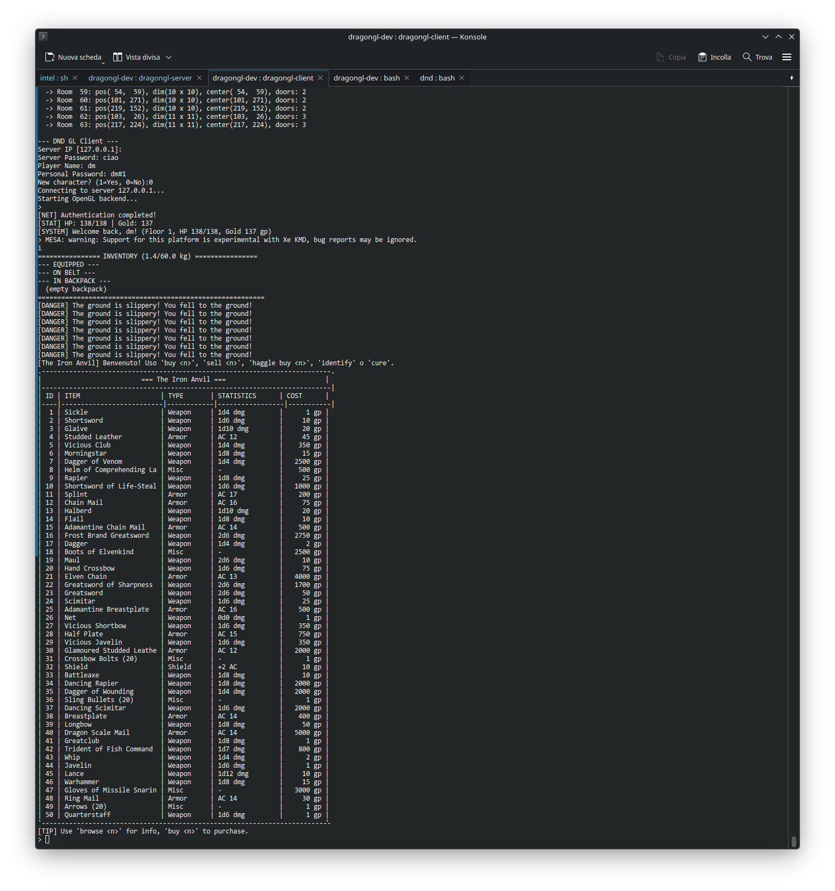
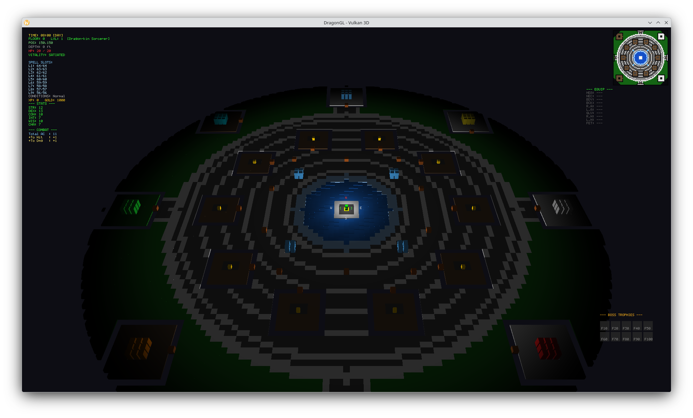
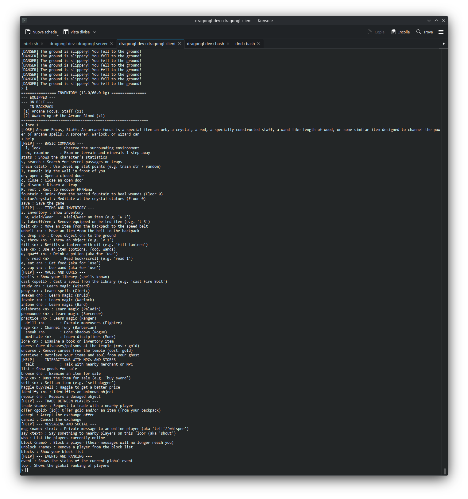

# Dragon GL: The Long Descent into the Dragon's Maw

[](https://github.com/nicolataibi/dragongl)
[](LICENSE.txt)
[](https://creativecommons.org/licenses/by/4.0/)
[](CMakeLists.txt)
[](shaders/)
[](https://copr.fedorainfracloud.org/coprs/nicolataibi/dragongl/)

> **Multi-User Client-Server 3D RPG Engine — Vulkan**

---

<table align="center">
  <tr>
    <td align="center">
      <div align="center">
        
        
      </div>
    </td>
  </tr>
</table>

---

**Dragon GL** is a high-performance, 3D multi-user client-server dungeon exploration simulator and RPG engine. Built from the ground up in modern C11, the engine features a fully functional open Fantasy RPG mechanical core (d20 ruleset) and a real-time 3D client built on **Vulkan 1.3 (GPU-driven, dynamic rendering)**.

- **Upstream Website:** [https://github.com/nicolataibi/dragongl](https://github.com/nicolataibi/dragongl)
- **Fedora COPR Repository:** [https://copr.fedorainfracloud.org/coprs/nicolataibi/dragongl/](https://copr.fedorainfracloud.org/coprs/nicolataibi/dragongl/)
- **Author:** Nicola Taibi (assisted by Gemini, ChatGPT, Qwen, Gemma)
- **Code License:** GPL-3.0-or-later
- **Asset License:** CC BY 4.0 (Creative Commons Attribution 4.0 International)

---

## Screenshots

<p align="center">
  
</p>

<p align="center">
  
  
</p>

<p align="center">
  
  
</p>

---

## Key Features

### 1. GPU-Driven Vulkan Renderer
- **Vulkan 1.3, GPU-driven (GPD):** dynamic rendering, no render passes. Compute shaders (`gpd_cull_map.comp`, `gpd_cull_dyn.comp`, `gpd_expand_*.comp`, `gpd_final.comp`) cull the instances around the player, generate their geometry into a storage buffer and write the indirect draw command; a single `vkCmdDrawIndirect` renders the scene.
- **Robust presentation:** three frames in flight, one render-finished semaphore per swapchain image, swapchain rebuilt on resize and on `OUT_OF_DATE`/`SUBOPTIMAL`; resizable window (80% of the screen by default); best GPU picked automatically (`DRAGONGL_GPU` to override). Clean under the Khronos validation layer.
- **Spell VFX:** a particle engine renders the spell effects (projectiles, radial explosions, auras) sent by the server in `MSG_SPELL_VFX`.

### 2. High-Performance Client-Server Engine
- **Non-blocking Multiplexing:** Server handles up to 64 concurrent players via a POSIX `poll()` TCP architecture.
- **D3ES (Data-Driven Decoupled Entity System):** Static archetypes/blueprints are segregated from lightweight dynamic instances for cache-efficient processing.
- **Constant-Time $O(1)$ Spatial Partitioning:** Occupancy grid (`entity_grid`) provides instant collision detection, line-of-sight checks, and target queries.
- **FloorStats Cache:** Incremental lifecycle tracking (`floor_stats_npc_died()`, `floor_stats_npc_spawned()`) eliminates expensive full-map iterations.

### 3. Open RPG Ruleset Implementation (d20)
- **Polyhedral Dice Math:** True RNG engine supporting d4, d6, d8, d10, d12, and d20 dice rolls with Advantage/Disadvantage mechanics and Saving Throws.
- **52 Playable Ancestries (Races):** Extensive variety including Human, Elf, Dwarf, Gnome, Orc, Dragon-kin, Giant-kin, Celestial-blood, Fiend-blood, and dozens of exotic lineages.
- **12 Heroic Professions (Classes):** Wizard, Paladin, Cleric, Druid, Fighter, Monk, Ranger, Rogue, Sorcerer, Warlock, Barbarian, and Bard.
- **Survival Mechanics:** Realistic hunger bar, exhaustion levels, 10+ status conditions (Poisoned, Blinded, Paralyzed, Burning, Bleeding, Petrified, Frozen, Cursed, etc.), and end-of-turn recovery rolls.
- **Geology & Mining System:** Interactive voxel mining (`examine`, `tunnel <dir>`) with tool validation (Picks, Shovels) allowing players to extract gold veins, silver, and precious crystals.

### 4. World Dynamics & Progression
- **100 Procedurally Generated Floors:** Created using cellular automata and Perlin noise.
- **Floor 0 Safe Sanctuary:** Open-air circular hub featuring 11 specialized merchant shops, 8 class temples, 4 martial training dojos, sacred fountains, and meditation crystal statues.
- **Boss Gating (Every 10 Floors):** Floors 10, 20, 30... 100 house massive boss encounters dynamically drawn from native depth pools. Defeating the boss illuminates a trophy on the client HUD and unlocks deeper stairs.
- **Wandering Merchants (Every 5 Floors):** Errant traders (Blacksmith, Alchemist, Scroll Peddler, Wand Weaver, Arcane Smuggler) appear in deep dungeon levels with depth-scaled inventories.
- **Multiplayer Economy & Social Features:** Charisma-based haggling mini-game (`haggle`), Party system with shared XP, synchronized two-phase item trading, and local Chebyshev-distance spatial chat.

---

## Package Architecture (Fedora COPR / RPM)

The Fedora packaging divides Dragon GL into modular subpackages conforming to the Fedora Packaging Guidelines:

| Package | Architecture | Contents |
| :--- | :--- | :--- |
| **`dragongl`** | Arch-dependent | Vulkan client (`dragongl-client`), its SPIR-V shaders (`/usr/share/dragongl/shaders/`) and man pages. |
| **`dragongl-server`** | Arch-dependent | Server (`dragongl-server`), world reset utility (`dragongl-reset-world`), world generator, systemd unit `dragongl-server.service` and `/etc/dragongl/dragongl-server.conf`. |
| **`dragongl-data`** | `noarch` | Game datasets (`bestiary.json`, `items.json`, `spells.json`) in `/usr/share/dragongl/data/`. |
| **`dragongl-tools`** | `noarch` | DM and developer tools: balance analyzer (`analyze_balance.py`), map PDF generator (`generate_pdf_map.py`), and the HTML Data Studio suite. |
| **`dragongl-doc`** | `noarch` | User manuals and technical documents (`/usr/share/doc/dragongl/`). |

The artwork in `readme_assets/` (CC BY 4.0, see `readme_assets/LICENSE.md`) stays in the repository: it is not part of the release tarball nor of any package. Service setup: [INSTALL.md](INSTALL.md).

--- | :--- | :--- |
| **`dragongl`** | Arch-dependent | Server binary (`dragongl-server`), Client binary (`dragongl-client`), world reset utility (`dragongl-reset-world`), and man pages. |
| **`dragongl-data`** | `noarch` | Game datasets (`bestiary.json`, `items.json`, `spells.json`) and compiled Vulkan SPIR-V shaders (`/usr/share/dragongl/`). |
| **`dragongl-tools`** | `noarch` | Developer and DM tools: balance analyzer (`analyze_balance.py`), map PDF generator (`generate_pdf_map.py`), and the HTML Data Studio suite. |
| **`dragongl-doc`** | `noarch` | User manuals, technical documents, and documentation image assets (`/usr/share/doc/dragongl/`). |

---

## Installation on Fedora Linux (via COPR)

Pre-built RPM packages for Fedora are available through Fedora COPR:

```bash
# 1. Enable the COPR repository
sudo dnf copr enable nicolataibi/dragongl

# 2. Client, or server host (pulls in dragongl-data)
sudo dnf install dragongl
sudo dnf install dragongl-server dragongl-tools
```

---

## Building from Source

### 1. Build Prerequisites (Fedora Linux)

Install the required compiler, build tools, and graphics development headers:

```bash
sudo dnf install -y \
    cmake \
    clang \
    glfw-devel \
    vulkan-loader-devel \
    glslc \
    pkgconf-pkg-config \
    libsodium-devel \
    python3
```

### 2. Compilation via CMake

Dragon GL uses standard CMake out-of-source builds with clang:

```bash
# Release build of client and server, then both test suites
./build.sh

# The same by hand
cmake -B build -DCMAKE_BUILD_TYPE=Release
cmake --build build --parallel $(nproc)
```

`./build.sh -S` builds the server only (no Vulkan or GLFW needed); all switches and CMake options are in [BUILD.md](BUILD.md).

---

## Running Dragon GL

### 1. Launching the Server (`dragongl-server`)

The server manages world state, NPC AI, combat resolution, and multiplayer synchronization:

```bash
# Interactive: the launcher asks for the server and DM passwords
./dragongl-server

# Passwords from files (first line, chmod 600) and a custom port
./dragongl-server --password-file server.pw --dm-password-file dm.pw --port 8080

# Explicit data directory path
./dragongl-server --password-file server.pw --data-dir /path/to/data
```

Passwords are never accepted on the command line: they come from files, from `DRAGONGL_SERVER_PASSWORD` / `DRAGONGL_DM_PASSWORD`, or from the interactive prompt. Each one has 8-63 printable ASCII characters without spaces. Without a DM password the `dm` account is disabled.

*Data directory resolution order:* `--data-dir` argument -> `$DRAGONGL_DATA_DIR` -> `data/` of the source tree (binary in `build/`) -> `/usr/share/dragongl/data` (installed). The current directory is never searched. On an RPM install the server usually runs as the `dragongl-server` systemd service ([INSTALL.md](INSTALL.md)).

### 2. Launching the Client (`dragongl-client`)

The client renders with Vulkan 1.3 (a GPU and driver with Vulkan 1.3 are required):

```bash
# Asks for the server host, then for the credentials
./dragongl-client

# Connect to a remote server (host name, IPv4 or IPv6 address)
./dragongl-client 192.168.1.50 8080

# Window size, GPU choice, validation layer
DRAGONGL_WINDOW=1920x1080 DRAGONGL_GPU=1 VK_INSTANCE_LAYERS=VK_LAYER_KHRONOS_validation ./dragongl-client
```

### 3. Resetting the Game World (`dragongl-reset-world`)

To wipe temporary server saves and reset world persistence:

```bash
./dragongl-reset-world
```

---

## Player Quick Reference & Controls

Dragon GL features a classic NetHack/Angband-style console interface alongside real-time 3D movement:

### Essential Console Commands

| Category | Commands | Description |
| :--- | :--- | :--- |
| **Inventory & Gear** | `i`, `inventory` | View backpack, belt, and equipped items |
| | `w`, `wear <item>` | Equip weapon, armor, amulet, or ring |
| | `takeoff <slot>` | Unequip item back into backpack |
| | `use <item>`, `eat` | Consume potion, wand, or food rations |
| | `get`, `drop <item>` | Pick up or drop ground items |
| **Exploration & World**| `look`, `l` | Detailed 8-direction radial scan of entities and terrain |
| | `examine`, `ex` | Geological scan for mineral and crystal veins |
| | `tunnel <dir>` | Mine or dig (n, s, e, w, d) with pickaxe/shovel |
| | `open <dir>`, `close`| Open or close adjacent doors |
| | `disarm [salvage]` | Attempt to disarm adjacent traps (or harvest parts) |
| **Survival & Magic** | `status`, `stats` | View character sheet, modifiers, conditions, AC |
| | `rest`, `R` | Rest in safe zone (Floor 0) to recover HP and spell slots |
| | `spells`, `cast <name>`| List and cast memorized spells |
| | `study <n>`, `pray <n>`| Learn spells inside your class's Floor 0 temple |
| **Town & Services** | `talk`, `list` | Speak with merchant and browse goods |
| | `buy <n>`, `sell <n>`| Purchase or sell wares |
| | `haggle buy/sell <n>`| Negotiate item prices based on Charisma |
| | `identify [n]` | Identify unidentified items at an alchemist (100 gp) |
| | `repair` | Repair combat-worn equipment at the blacksmith |
| **Social & Chat** | `say <text>` | Local floor chat (12-tile radius) |
| | `msg <player> <text>`| Private whisper to a player |
| | `who` | View list of online adventurers and their current floor |
| | `block <player>` | Block messages and chat from a player |

---

## Dungeon Master (DM) & Developer Tools

Dragon GL includes a dedicated administrative role for game masters and automated balance analytics:

### DM Privileges & Commands

To authenticate as DM: connect with player name `dm` and the DM password configured at server startup (`--dm-password-file` or `DRAGONGL_DM_PASSWORD`; without it the DM account is disabled):

- `dm_telemetry`: Real-time server telemetry (tick timing, active clients, live NPCs, traps).
- `dm_goto <floor> <x> <y>`: Instant teleportation across all 100 floors.
- `dm_spawn <monster_id> <x> <y>`: Spawn creatures from the bestiary.
- `dm_boss <floor>`: Retrieve location, statistics, and loot tables for floor bosses.
- `dm_merchant <floor>`: Locate errant traders and inspect their restock state.
- `dm_place <item_id> <x> <y>`: Spawn chests with specific items.
- `dm_pdf <floor>`: Export a 2D color PDF map representation of any dungeon floor.

### Game Balance Analysis Tool (`tools/analyze_balance.py`)

All combat interactions are written in real-time to `combat_log.json` in the server state directory (`state/` in a development tree, `~/.local/state/dragongl/` for an installed server). Developers can evaluate combat balance using the bundled Python analyzer, which finds that file by itself:

```bash
python3 tools/analyze_balance.py                          # state directory of this tree
python3 tools/analyze_balance.py /path/to/combat_log.json # any other log
```

The tool produces statistical breakdowns for:
1. **Attack Report:** Overall accuracy, critical strike frequency, damage per hit, and top-damage units.
2. **Saving Throw Report:** Pass/fail rates by effect type and DC difficulty distribution.
3. **Spell Report:** Output efficiency and resist rates for all cast spells.
4. **Lethality Report:** Floor-by-floor death distribution ASCII graph and top killer rankings.

### Web Data Studio (`tools/web/`)

Interactive HTML5/JavaScript editors for inspecting and modifying game datasets:
- Bestiary manager: `tools/web/bestiary.html`
- Items database: `tools/web/items.html`
- Spells & Prayers: `tools/web/spells.html`

---

## Documentation Index

- [HOWTO.md](HOWTO.md) — Quick-start guide and basic invocation commands
- [LORE.md](LORE.md) — Comprehensive narrative, dungeon chronicle, and chapter lore
- [PROTOCOL.md](PROTOCOL.md) — Network wire protocol and packet specification
- [SECURITY.md](SECURITY.md) — Security policy and vulnerability reporting
- [LICENSE.txt](LICENSE.txt) — GNU General Public License v3.0 text
- [dragongl.spec](dragongl.spec) — Fedora RPM and COPR packaging specification

---

## Authors and Acknowledgments

- **Lead Developer & Creator:** Nicola Taibi
- **AI Design & Development Assistance:** Gemini (Google AI), ChatGPT (OpenAI), and local models Qwen & Gemma.
- **Graphical Assets & Artworks:** Curated and prompted by Nicola Taibi, generated via AI tools, licensed under [CC BY 4.0](https://creativecommons.org/licenses/by/4.0/).
- **License:** Software licensed under [GPL-3.0-or-later](LICENSE.txt).
